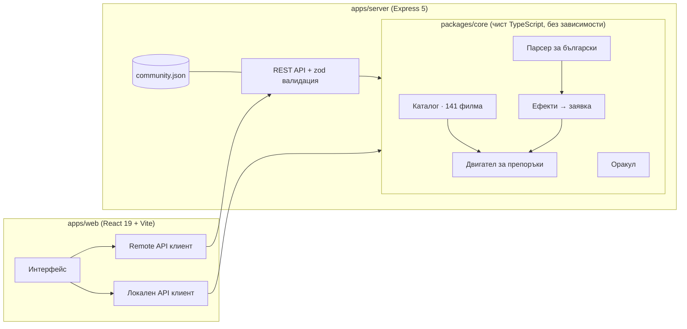

# MoodReel – филм според настроението

> „Искам нещо страшно, но не прекалено.“ · „Нещо объркващо като The Thing или Black Swan.“ · „Избери ми филм, не искам тъжен край.“

MoodReel не е поредният сайт с ревюта и трейлъри. Пишеш как се чувстваш на нормален български, а сайтът го превръща в конкретни желания, изключва това, което не искаш (без да издава краищата), подрежда 141 ръчно описани филма и накрая завърта лента, която спира на един от тях.

## Какво може

| | |
|---|---|
| **Кажи го с думи** | Собствен парсер за български (и смесен английски): разбира модификатори („не прекалено“, „много“, „малко“, „по-малко страшно“), отрицания, препратки към филми („като Черният лебед“, „в стил Нолан“), години („от 80-те“), дължина („под час и половина“), компания („с децата“, „за среща“) и дори състояние („кофти ден съм“ → нещо за повдигане, а не тъжен филм). Всяко разбрано нещо става чип, който можеш да махнеш. |
| **Без тъжен край – без спойлери** | Условия като „без тъжен край“, „без кръв“, „без стряскания“, „животните оцеляват“, „подходящ за деца“. Контактният лист показва целия каталог като кадри от лента; изключените угасват с причината, но видът на края остава скрит, докато сам не го отключиш. |
| **Пулт** | Карта на настроенията (всички филми като точки по интензивност × мрачност, с плъзгаща се шайба), фини плъзгачи за 10 измерения и готови вечери („Петък с приятели“, „Сам в 2 през нощта“…). |
| **Избери ми филм** | Претеглен жребий между най-добрите съвпадения, анимиран като въртяща се филмова лента, който завършва с кино билет: защо точно този филм, отпечатък на настроението му спрямо твоето желание, „Гледам го!“ / „Друг“ / „Гледал(а) съм го“. |
| **Оракулът** | Akinator за филми: всеки следващ въпрос е този с най-голяма очаквана информационна печалба спрямо оставащите филми. Обикновено стигат 5–8 въпроса. |
| **Моят списък** | Запазени и гледани филми (гледаните не се предлагат повече). |
| **Пулс** | Какво избират хората тази седмица и какво търсят спрямо средното – анонимно, от гласовете „Гледам го!“. |

## Архитектура



- **`packages/core`** – цялата логика, споделена между сървъра и браузъра: типове, каталог, NLP парсер, препоръчващ двигател, жребий и оракул. Без нито една външна зависимост; 190 теста.
- **`apps/server`** – Express 5 API: валидация със zod, rate limiting, helmet (CSP), компресия, структурирани логове, грациозно спиране и JSON хранилище с атомарни записи (temp файл + rename) за гласовете на общността. В production сервира и билднатия клиент.
- **`apps/web`** – React клиент. Един и същ договор (`Api`) има две реализации: HTTP клиент към сървъра и локална, която пуска двигателя в браузъра. Ако при зареждане сървърът не отговаря, сайтът минава тихо на локалния режим. Така същият код се билдва и като **един HTML файл** без сървър.

### Как се смята съвпадението

1. Всеки филм има профил по 10 измерения от 0 до 10: страх, напрежение, мозъчна гимнастика, смях, романтика, екшън, тъга, мрачност, магия, темпо. Плюс вид на края (светъл / горчиво-сладък / отворен / тъжен / мрачен), предупреждения за съдържание и възрастова препоръка.
2. Всяко желание е ограничение `{ target, tolerance, min, max, weight }`. Съвпадението по едно измерение е гаусово около целта, с рязко наказание извън min/max.
3. Измеренията се комбинират с **претеглена геометрична средна** – едно силно пропуснато желание сваля целия резултат, както и трябва. Към нея влизат сходството с примерни филми (разстояние в профилното пространство + Jaccard по теми), жанров афинитет („страшно“ предпочита хорър пред военен филм със страх 4) и ключови думи.
4. **Maximal Marginal Relevance** избира кои 12 филма да се покажат, за да не са десет копия на един и същ.
5. Гласовете на общността влизат като малък (±5%) байесов приор с Beta(2, 2), така че един щастлив глас не изстрелва филм най-горе.
6. „Избери ми филм“ тегли със softmax по резултата – почти винаги от върха, но не роботски.

### Оракулът

Всички филми започват с еднакво тегло. Всеки въпрос има мека вероятност p(филм) отговорът да е „да“. Отговорът („да“, „по-скоро да“, „все ми е едно“…) обновява теглата байесово, със 7% шум, защото хората (и ръчните оценки) грешат. Следващият въпрос е този, който минимизира очакваната ентропия. API-то е stateless – клиентът праща историята, сървърът я преиграва.

## Пускане

Нужен е **Node.js 22.12+**.

```bash
cd MoodReel
npm install
npm run dev        # API на :4000 + Vite на :5173 (с proxy към API)
```

Отвори http://localhost:5173.

| Скрипт | Какво прави |
|---|---|
| `npm run dev` | Сървър и клиент в режим на разработка (hot reload). |
| `npm test` | Всички тестове (core, server, web). |
| `npm run typecheck` | TypeScript проверка на трите пакета. |
| `npm run build` | Production билд на клиента и бъндъл на сървъра (esbuild). |
| `npm start` | Пуска production сървъра на :4000; той сервира и клиента. |
| `npm run build:static` | Целият сайт като един HTML файл в `apps/web/dist-standalone/` – работи без сървър (GitHub Pages, флашка, имейл). |

### Настройки на сървъра

| Променлива | По подразбиране | |
|---|---|---|
| `PORT` | `4000` | |
| `HOST` | `0.0.0.0` | |
| `DATA_DIR` | `./data` | Къде се пази `community.json`. |
| `WEB_DIST` | `../web/dist` | Билднатият клиент; празно = само API. |
| `TRUST_PROXY` | `0` | Брой прокси хопове пред сървъра (за коректен rate limit). |
| `NODE_ENV` | `development` | `production` включва JSON логове. |

## API

Всички отговори са JSON; грешките имат вида `{ error, message, issues? }` със съобщение на български.

| Метод | Път | |
|---|---|---|
| GET | `/api/health` | Жив ли е сървърът. |
| GET | `/api/movies` | Каталогът (кешира се 5 мин). |
| GET | `/api/movies/:id` | Един филм + 6 най-близки. |
| POST | `/api/parse` | `{ text }` → разбраните ефекти, режим `replace`/`refine`, непознати думи, усетено настроение. |
| POST | `/api/recommend` | `{ query, limit?, seed? }` → резултати с причини + отчет кой филм защо е изключен. |
| POST | `/api/pick` | `{ query, seed? }` → избраният филм, кадрите за лентата, алтернативи. Възпроизводимо по `seed`. |
| POST | `/api/oracle` | `{ history, query? }` → следващ въпрос или присъда. |
| POST | `/api/feedback` | `{ clientId, movieId, verdict, mood? }` – анонимен глас, един на човек на 6 часа. |
| GET | `/api/stats` | Пулсът на общността за седмицата. |

## Структура

```
MoodReel/
├── packages/core/        # двигател, парсер, оракул, каталог (+ тестове)
│   └── src/
│       ├── catalog/      # 141 ръчно описани филма
│       ├── engine/       # филтри, скоринг, MMR, жребий, сходство
│       ├── nlp/          # нормализация, речник, заглавия, парсер
│       └── oracle/       # въпроси и информационна печалба
├── apps/server/          # Express API, хранилище, middleware (+ тестове)
└── apps/web/             # React клиент, стилове, тестове на състоянието
```

## Бележки за данните

- Профилите по настроение, видът на края и предупрежденията са оценени ръчно за проекта. Те са субективни – точно затова интерфейсът винаги показва числата и причините.
- Плакатите не са свалени отникъде: всеки се генерира от кода по палитрата и жанра на филма. Няма външни API ключове, няма проследяване.
- Описанията са без спойлери; видът на края е скрит зад бутон.
