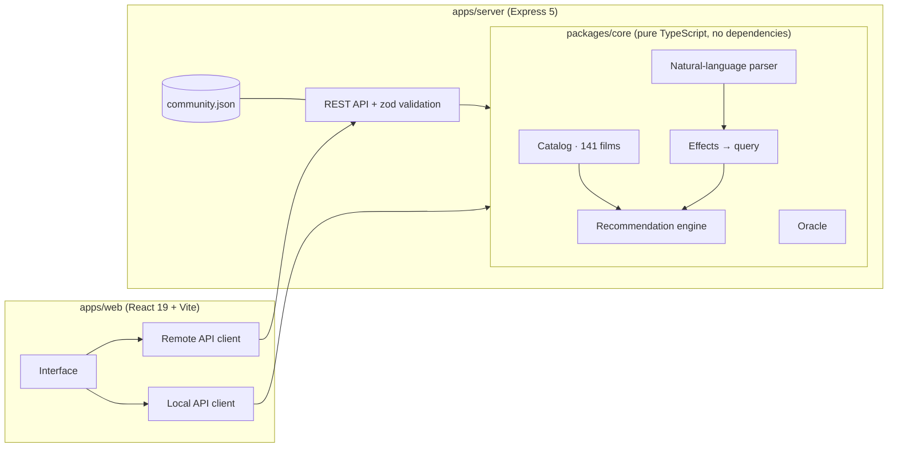

# MoodReel – pick a film by how you feel

> “I want something scary, but not too much.” · “Something mind-bending like The Thing or Black Swan.” · “Pick me a movie, no sad endings.”

MoodReel is not another site full of reviews and trailers. You describe how you feel in plain English, and the site turns that into concrete wishes. It rules out what you don't want (without giving away any endings), ranks 141 hand-profiled films and finally spins a reel that stops on one of them.

## What it does

| | |
|---|---|
| **Say it in words** | A hand-written natural-language parser understands modifiers (“not too”, “very”, “a little”, “less scary”, “even darker”), negation, references to films (“like Black Swan”, “something like Nolan”), eras (“from the 80s”), length (“an hour and a half max”), company (“with the kids”, “date night”) and even your own state (“had a bad day” → something uplifting, not a sad film). Every recognised wish becomes a chip you can remove. Bulgarian input works too. |
| **No sad ending, no spoilers** | Rules such as “no sad ending”, “no gore”, “no jump scares”, “the animals survive” and “kid-friendly”. The contact sheet shows the whole catalog as film frames; excluded ones go dark with the reason, but the kind of ending stays hidden until you unlock it yourself. |
| **Control desk** | A mood map (every film plotted by intensity × darkness, with a draggable puck), fine-tune sliders for 10 dimensions and ready-made evenings (“Friday with friends”, “Alone at 2 a.m.”…). |
| **Pick a film for me** | A weighted draw among the best matches, animated as a spinning film reel, ending in a cinema ticket: why this film, its mood fingerprint against your wish, and “I'll watch it!” / “Another” / “Seen it”. |
| **The Oracle** | Akinator for films: each next question is the one with the highest expected information gain over the films still left. Five to eight questions usually do it. |
| **My list** | Saved and already-seen films (seen films are no longer suggested). |
| **Pulse** | What people picked this week and what they look for compared with the midpoint, built anonymously from “I'll watch it!” votes. |

## Architecture



- **`packages/core`** – all the logic, shared by the server and the browser: types, catalog, parser, recommendation engine, the draw and the oracle. No external dependencies; 198 tests.
- **`apps/server`** – an Express 5 API with zod validation, rate limiting, helmet (CSP), compression, structured logs, graceful shutdown and a JSON store with atomic writes (temp file + rename) for community votes. In production it also serves the built client.
- **`apps/web`** – the React client. One contract (`Api`) has two implementations: an HTTP client for the server and a local one that runs the engine in the browser. If the server does not answer at startup, the site quietly switches to local mode. The same code therefore also builds into **a single HTML file** that needs no server.

### How a match is scored

1. Every film has a profile on 10 dimensions from 0 to 10: fear, tension, mind-bending, laughs, romance, action, tears, darkness, wonder and pace. Plus the kind of ending (bright / bittersweet / open / sad / bleak), content warnings and an age rating.
2. Every wish is a constraint `{ target, tolerance, min, max, weight }`. The fit on one dimension is Gaussian around the target, with a steep penalty outside min/max.
3. Dimensions combine through a **weighted geometric mean**, so one badly missed wish drags the whole score down, as it should. Similarity to example films (distance in profile space plus Jaccard over themes), genre affinity (“scary” prefers horror over a war film that happens to score 4 on fear) and keywords join the same mean.
4. **Maximal Marginal Relevance** decides which 12 films to show, so the list is not ten copies of the same film.
5. Community votes enter as a small (±5%) Bayesian prior with Beta(2, 2), so one lucky vote cannot launch a film to the top.
6. “Pick a film for me” draws with a softmax over the scores: almost always from the top, but not robotically.

### The Oracle

All films start with equal weight. Every question has a soft probability p(film) that the honest answer is “yes”. Each answer (“yes”, “probably”, “don't care”…) updates the weights Bayes-style, with 7% noise because people (and hand-scored profiles) are not perfect. The next question is the one that minimises the expected entropy. The API is stateless: the client sends the history and the server replays it.

## Running it

You need **Node.js 22.12+**.

```bash
cd MoodReel
npm install
npm run dev        # API on :4000 + Vite on :5173 (proxying to the API)
```

Open http://localhost:5173.

| Script | What it does |
|---|---|
| `npm run dev` | Server and client in development mode (hot reload). |
| `npm test` | Every test (core, server, web). |
| `npm run typecheck` | TypeScript check of all three packages. |
| `npm run build` | Production build of the client and an esbuild bundle of the server. |
| `npm start` | Starts the production server on :4000; it also serves the client. |
| `npm run build:static` | The whole site as one HTML file in `apps/web/dist-standalone/`, which works without a server (GitHub Pages, a USB stick, an email attachment). |

### Server settings

| Variable | Default | |
|---|---|---|
| `PORT` | `4000` | |
| `HOST` | `0.0.0.0` | |
| `DATA_DIR` | `./data` | Where `community.json` is stored. |
| `WEB_DIST` | `../web/dist` | The built client; empty means API only. |
| `TRUST_PROXY` | `0` | Number of proxy hops in front of the server (for correct rate limiting). |
| `NODE_ENV` | `development` | `production` switches on JSON logs. |

## API

Every response is JSON; errors look like `{ error, message, issues? }`.

| Method | Path | |
|---|---|---|
| GET | `/api/health` | Is the server alive. |
| GET | `/api/movies` | The catalog (cached for 5 minutes). |
| GET | `/api/movies/:id` | One film plus its 6 nearest neighbours. |
| POST | `/api/parse` | `{ text }` → recognised effects, `replace`/`refine` mode, unknown words, detected mood. |
| POST | `/api/recommend` | `{ query, limit?, seed? }` → results with reasons, plus a report of which film was excluded and why. |
| POST | `/api/pick` | `{ query, seed? }` → the chosen film, the frames for the reel, alternatives. Reproducible by `seed`. |
| POST | `/api/oracle` | `{ history, query? }` → the next question or the verdict. |
| POST | `/api/feedback` | `{ clientId, movieId, verdict, mood? }` – an anonymous vote, one per person every 6 hours. |
| GET | `/api/stats` | The community pulse for the week. |

## Layout

```
MoodReel/
├── packages/core/        # engine, parser, oracle, catalog (+ tests)
│   └── src/
│       ├── catalog/      # 141 hand-profiled films
│       ├── engine/       # filters, scoring, MMR, draw, similarity
│       ├── nlp/          # normalisation, vocabulary, titles, parser
│       └── oracle/       # questions and information gain
├── apps/server/          # Express API, store, middleware (+ tests)
└── apps/web/             # React client, styles, state tests
```

## Notes on the data

- Mood profiles, ending types and content warnings were scored by hand for this project. They are subjective, which is exactly why the interface always shows the numbers and the reasons.
- No posters are downloaded from anywhere: each one is generated in code from the film's palette and genre. No external API keys, no tracking.
- Blurbs contain no spoilers; the kind of ending sits behind a button.
